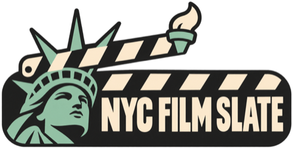

# NYC Film Slate

<p align="center">
  
</p>

**Live website:** [yeyekuailai.github.io/nyc-independent-cinermas-slate](https://yeyekuailai.github.io/nyc-independent-cinermas-slate/)

NYC Film Slate brings independent cinema schedules, official ticket links, and film ratings into one simple view. It currently covers Film at Lincoln Center, Japan Society, Metrograph, and Film Forum, with room to add more cinemas over time.

## What the site includes

- Screening schedules organized by date and cinema
- Direct links to official ticket pages
- Douban and IMDb ratings and film-detail links
- Separate showtimes when the same film plays at multiple cinemas
- A publishing audit that blocks stale or incomplete rating data

## What is Douban?

[Douban Movie](https://movie.douban.com/) is a Chinese-language film discovery and review platform. It includes community ratings, written reviews, cast and crew information, and discussion around films. It can provide especially useful context for Chinese and other Asian cinema, complementing the more internationally familiar IMDb.

NYC Film Slate displays Douban and IMDb side by side because the two communities may evaluate the same film differently. Their ratings are useful points of reference, not interchangeable measurements.

## Logo concept

The selected identity combines two instantly recognizable ideas:

- The **Statue of Liberty** represents New York City.
- The **clapperboard** represents cinema, screenings, and the act of making a film.

The crown grows into the clapper hinge, while the torch completes the top of the slate. Liberty copper green references the statue's patina; charcoal and warm cream evoke theater signage and printed film-program ephemera. The result is designed to feel local, cinematic, and readable at both website-header and favicon sizes.

The green festival-badge direction was selected for the final website. All three original concepts remain in [`brand/concepts`](brand/concepts/) as part of the project's visual-design process, without being displayed in this README.

## Data validation

```bash
npm run ratings:audit
```

GitHub Pages runs the ratings audit before every deployment. If the schedule changes without a matching ratings sync, deployment fails. Rating updates are transactional: a failed source request cannot silently overwrite previously valid data.
